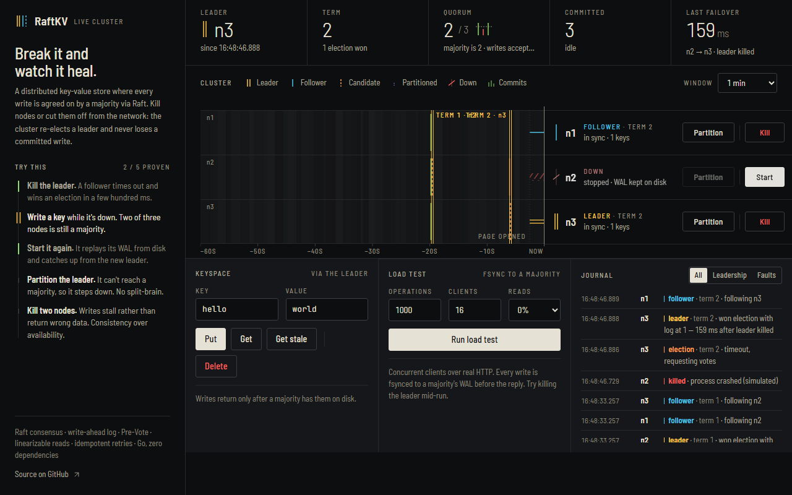
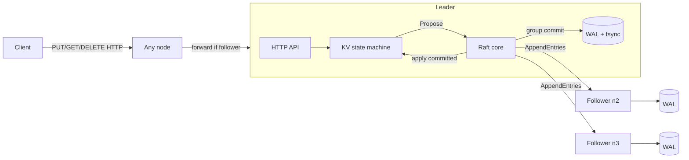

# RaftKV

**A fault-tolerant, strongly consistent distributed key-value store built on the Raft consensus algorithm, from scratch in Go with zero dependencies.**

Run 3–5 nodes that agree on every write. Kill the leader and the cluster elects a new one in ~150–300 ms without losing a single acknowledged write. Partition the network and the minority side stops accepting writes instead of diverging (no split-brain).

[](https://github.com/Lecrupus/raftkv/actions/workflows/ci.yml)

### ▶ Live demo: **[raftkv-z7ka.onrender.com](https://raftkv-z7ka.onrender.com)**
Kill the leader, partition nodes, run a benchmark, all in the browser. _(Free hosting sleeps when idle; the first load can take ~30 s.)_



---

## Highlights

| | |
|---|---|
| **Consensus** | Leader election with randomized timeouts, log replication with fast conflict backtracking, commit rules incl. the Figure-8 rule (leader commits a no-op in its term) |
| **Pre-Vote + leader stickiness** | A node returning from a partition can't inflate its term and depose a healthy leader (Raft thesis §9.6) |
| **Check-quorum** | A leader that loses contact with a majority steps down, so an isolated leader stops serving instead of hanging clients |
| **Durability** | Checksummed write-ahead log (CRC32 per record), fsync before acknowledging, torn-write detection, compaction on restart |
| **Group commit** | Leader persists entries in batches, in parallel with replication: **3× throughput, 4.5× lower p99** vs. fsync-per-write |
| **Linearizable reads** | Reads go through the log; optional `?consistency=stale` local reads for comparison |
| **Exactly-once writes** | Client ID + sequence number dedup, so retries after a timeout are safe |
| **Verification** | Jepsen-style linearizability checker (Wing–Gong/Lowe search) run against histories recorded under crashes, partitions and message loss |
| **Ops** | Docker Compose cluster, Prometheus `/metrics`, chaos script, live web dashboard, CI |

## Architecture



**Write path:** client → any node (followers forward to the leader) → `kv.Store.Do` proposes the op → leader appends it to its log, the persister fsyncs it in a batch, and replicators send `AppendEntries` to followers, who fsync before replying → once a majority (leader included only after its own fsync) has it, the entry is **committed** → applied to the map in log order → the waiting request gets its result.

**Read path:** linearizable reads are proposed through the log like writes, so a deposed leader can never serve stale data. `?consistency=stale` reads the local replica (fast, possibly old). The linearizability checker catches the difference; see [Testing](#testing).

```
raft/       consensus core: election, pre-vote, replication, commit, WAL, in-memory test network
kv/         replicated state machine, request dedup, end-to-end linearizability tests
lincheck/   linearizability checker (WGL search with memoization, per-key P-compositionality)
server/     HTTP transport for Raft RPCs + client API, leader forwarding, Prometheus metrics
cluster/    in-process multi-node cluster + dashboard (used for the hosted demo)
bench/      closed-loop load generator
cmd/raftkv  single binary: `node`, `cluster`, `bench`
```

## Results

Measured on a laptop (Windows 11, Docker Desktop), 3 nodes in separate containers, 64-byte values, **every write fsynced on a majority before it is acknowledged**:

| Workload | Throughput | p50 | p99 |
|---|---:|---:|---:|
| 1 client, writes | 211 ops/s | 4.5 ms | 8.0 ms |
| 16 clients, writes | 752 ops/s | 20.7 ms | 35.4 ms |
| 64 clients, writes | 1,884 ops/s | 32.5 ms | 57.3 ms |
| 16 clients, 90% linearizable reads | 701 ops/s | 21.1 ms | 47.2 ms |

**Group commit** (16 clients): 248 → 752 ops/s, p99 159 → 35 ms.

**Hosted demo** (Render free tier, whole 3-node cluster on 0.1 vCPU): leader killed → new leader in **148 ms**; leader partitioned → **176 ms**, and the healed node rejoins without forcing a new election (pre-vote).

**Failover:** a new leader is elected **~130–180 ms** after the old one is killed or partitioned (election timeout randomized in 150–300 ms).

**Chaos:** `scripts/chaos.sh` SIGKILLs a random node (often the leader) every round, keeps writing, restarts it, and verifies every acknowledged write through every node: **0 lost writes**. 50 seeded runs of the in-memory chaos and linearizability suites pass.

## Testing

```bash
go test ./...                                  # unit + integration
CHAOS_RUNS=100 go test -run Chaos ./raft ./kv  # 100 seeded chaos runs each
```

- **`raft/`**: election, re-election, 5-node replication, minority partition cannot commit, old leader steps down, rejoining node doesn't disrupt (pre-vote), full-cluster crash recovery, WAL torn-write and mid-log corruption, randomized chaos on a lossy network asserting **State Machine Safety** (no two nodes ever apply different commands at the same index).
- **`kv/`**: concurrent clients against a 5-node cluster while a nemesis crashes, restarts and partitions nodes with 2% message loss. Every operation's invocation/response time is recorded and the history is checked for **linearizability**. Timed-out writes are modelled as "may or may not have happened", as in Jepsen.
- **Does the checker have teeth?** Switching reads to stale local reads makes the checker reject the history on every seed. It catches real consistency bugs, not just crashes.

## Run it

[](https://render.com/deploy?repo=https://github.com/Lecrupus/raftkv)

**Demo cluster + dashboard (one process):**
```bash
go run ./cmd/raftkv cluster -port 8080      # open http://localhost:8080
```

**Real cluster, one container per node:**
```bash
docker compose up -d --build
curl -X PUT -d world localhost:8081/kv/hello
curl localhost:8082/kv/hello                  # served via the leader, linearizable
curl "localhost:8083/kv/hello?consistency=stale"
curl localhost:8081/status
ROUNDS=20 ./scripts/chaos.sh                  # kill nodes, verify nothing is lost
go run ./cmd/raftkv bench -clients 16 -duration 10s
docker compose --profile metrics up -d        # Prometheus at :9090
```

### API

| Method | Path | |
|---|---|---|
| `PUT` | `/kv/{key}` | body = value. Optional `X-Client-ID` + `X-Request-Seq` headers for exactly-once retries |
| `GET` | `/kv/{key}` | linearizable read; `?consistency=stale` for a local read |
| `DELETE` | `/kv/{key}` | |
| `GET` | `/status` | role, term, leader, commit/applied/log indices |
| `GET` | `/metrics` | Prometheus text format |

## Design decisions & trade-offs

- **CP, not AP.** Under a partition only the majority side makes progress; the minority refuses writes and linearizable reads. With 2 of 3 nodes down, writes stall rather than return wrong data.
- **Why the no-op on election?** Raft only counts replicas for entries from the leader's *current* term (Figure 8). Committing a no-op immediately commits everything before it, and lets the new leader learn its commit index.
- **Why Pre-Vote?** Without it, a node cut off by a partition keeps incrementing its term; when it reconnects, its higher term forces the healthy leader to step down. I hit this in the dashboard (term jumped 3 → 11 after healing) and fixed it, with a regression test.
- **Leader fsync in parallel with replication** is safe because commitment needs a durable majority; the leader counts toward that majority only for entries it has persisted.
- **Reads through the log** are simple and obviously correct but cost a round of replication. ReadIndex or leader leases are the faster next step.
- **HTTP/JSON transport** keeps the project dependency-free and debuggable with `curl`. gRPC/protobuf would cut serialization cost.

## Roadmap

- Log compaction with snapshots + `InstallSnapshot`
- ReadIndex / lease-based reads
- Membership changes (joint consensus or single-server changes)
- gRPC transport

## References

- Diego Ongaro & John Ousterhout, [*In Search of an Understandable Consensus Algorithm*](https://raft.github.io/raft.pdf) (2014)
- Diego Ongaro, [*Consensus: Bridging Theory and Practice*](https://github.com/ongardie/dissertation) (PhD thesis: pre-vote, leader stickiness, client sessions)
- Herlihy & Wing, *Linearizability* (1990); Lowe, *Testing for linearizability* (2017)
